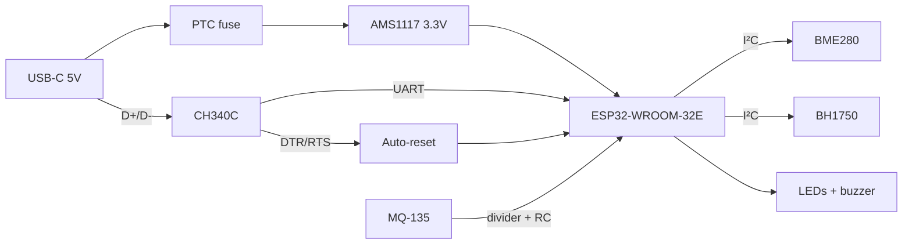

# KiCad PCB Sensor Board


A custom 2-layer ESP32 sensor board designed in KiCad. It replaces the breadboard prototype of my [ESP32 IoT Environmental Monitor](https://github.com/abdurrafayk900-ship-it/esp32-env-monitor) with a single USB-C powered board that has on-board USB programming, plug-in I²C sensor connectors and an MQ-135 gas sensor input.

<!-- After drawing the board in KiCad, export renders and uncomment:
<p align="center">
  
  
</p>
-->

## Highlights

| | |
|---|---|
| **MCU** | ESP32-WROOM-32E (Wi-Fi + BLE, 4 MB flash) |
| **Power** | USB-C (proper CC resistors) → PTC fuse → AMS1117-3.3 LDO |
| **Programming** | CH340C USB-UART + DTR/RTS auto-reset (no button presses to flash) |
| **Sensors** | 2× JST-SH Qwiic/STEMMA QT I²C ports (BME280, BH1750), 1× JST-PH for MQ-135 |
| **Analog front-end** | 5 V → 3.3 V divider + RC filter into ADC1 |
| **Outputs** | Power, OK and Alert LEDs, transistor-driven buzzer with flyback diode |
| **Board** | 50 × 40 mm, 2-layer, JLCPCB-compatible design rules, LCSC part numbers |
| **BOM cost** | ≈ $4.30 per board (parts only, see below) |

## Block Diagram



## Repository Contents

```
hardware/
├── netlist.csv        # every component pin → net (source of truth for the schematic)
├── bom.csv            # values, footprints, LCSC part numbers, cost
└── (KiCad project: sensor-board.kicad_pro / .kicad_sch / .kicad_pcb)
docs/
└── design-notes.md    # specs, design decisions, layout checklist
scripts/
└── check_design.py    # netlist ↔ BOM consistency checker (runs in CI)
```

## Design Verification

`scripts/check_design.py` checks the netlist against the BOM before layout. It flags dangling nets, pins assigned to two nets, parts missing from either file, quantity mismatches and missing power rails:

```text
$ python scripts/check_design.py
NET            PINS  CONNECTIONS
GND              23  J1.A1 J1.A12 R1.2 R2.2 C1.2 U1.1 C2.2 C3.2 ...
+3V3             14  U1.2 C2.1 C3.1 C4.1 U2.2 R3.1 R4.1 U3.16 ...
+5V               6  F1.2 C1.1 U1.3 J4.1 BZ1.1 D4.1
EN                5  U2.3 R3.2 C5.1 SW2.1 Q1.3
...
28 nets, 38 components, 38 placed parts
BOM cost: $4.30/board, $21.48 for 5 boards

All checks passed.
```

Inside KiCad, the release criteria are **ERC** and **DRC** with zero errors.

## Design Decisions

- **Antenna keep-out**: the module's antenna overhangs the board edge with no copper underneath, per Espressif guidelines
- **USB-C done right**: 5.1 kΩ CC pull-downs so C-to-C chargers actually supply power
- **ADC1 for analog**: IO34 still works while Wi-Fi is on (ADC2 pins don't)
- **Qwiic connectors**: common breakout boards plug in with no soldering
- **Solid ground pour** on the bottom layer, with stitching vias

More detail in [`docs/design-notes.md`](docs/design-notes.md).

## Ordering

1. In KiCad: **File → Fabrication Outputs → Gerbers + Drill Files**
2. Zip the output and upload to JLCPCB / PCBWay
3. For assembly, upload `bom.csv` and the CPL (position) file

## Tools

KiCad 8 · JLCPCB design rules · LCSC parts library · Python for design checks

## References

- [Espressif ESP32-WROOM-32E Datasheet & HW Design Guidelines](https://www.espressif.com/en/support/documents/technical-documents)
- [ESP32-DevKitC schematic](https://dl.espressif.com/dl/schematics/esp32_devkitc_v4-sch.pdf): auto-reset circuit reference
- [KiCad documentation](https://docs.kicad.org/)
- [Phil's Lab](https://www.youtube.com/@PhilsLab): KiCad PCB design tutorials

## License

MIT
