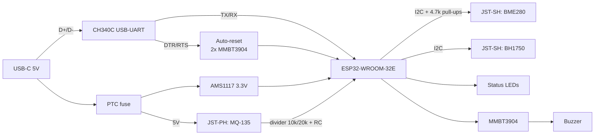

# Design Notes

## Board specification

| Parameter | Value |
|---|---|
| Size | 50 × 40 mm, 4× M3 mounting holes |
| Layers | 2 (top signal + components, bottom ground pour) |
| Thickness | 1.6 mm FR-4, 1 oz copper |
| Min trace / space | 0.2 mm / 0.2 mm (JLCPCB standard) |
| Min via | 0.3 mm drill / 0.6 mm pad |
| Power traces | 0.5 mm (+5V, +3V3), 0.3 mm signals |
| USB D+/D− | routed as a pair, equal length, 90 Ω differential target |
| Finish | HASL lead-free |

## Block diagram

## Key design decisions

**Power**
- The USB-C port has 5.1 kΩ pull-downs on CC1/CC2, so a C-to-C charger will actually supply 5 V. Without them, many chargers output nothing.
- The PTC fuse protects the host's USB port if something shorts.
- The AMS1117 has 22 µF on its output for stability. The ESP32's Wi-Fi TX bursts draw up to ~500 mA peaks.

**ESP32 module placement**
- The antenna end of the WROOM module overhangs the board edge, with **no copper (any layer) under the antenna**, per Espressif's hardware design guidelines.
- 100 nF decoupling is placed right at the module's 3V3 pin.

**Programming / auto-reset**
- The classic two-transistor DTR/RTS circuit (same as the official DevKitC) lets `esptool` enter bootloader mode without pressing BOOT.
- The EN pin has a 10 kΩ / 1 µF RC delay so the module resets cleanly after power-up.
- Manual BOOT and RESET buttons are kept for recovery.

**Sensors**
- The I²C sensors use **JST-SH 4-pin (Qwiic / STEMMA QT)** connectors, so off-the-shelf Adafruit/SparkFun breakouts plug straight in.
- A single pair of 4.7 kΩ pull-ups is fitted on the board. Remove the pull-ups on breakout boards if the bus has too many in parallel.
- The MQ-135 heater runs at 5 V, and its analog output goes through a 10 k/20 k divider (5 V → 3.33 V max) to ADC1 pin IO34, which still works while Wi-Fi is active. A 100 nF cap forms a low-pass filter.

**Buzzer**
- Driven through an NPN low-side switch from 5 V (the GPIO can't source enough current), with a flyback diode across the coil.

## Layout checklist

- [ ] Ground pour on both layers, stitched with vias every ~5 mm
- [ ] Antenna keep-out zone respected
- [ ] USB diff pair short and on one layer
- [ ] LDO thermal pad tied to copper pour for heat spreading
- [ ] Silkscreen: pin labels on every connector, board name, revision, date
- [ ] DRC + ERC pass with zero errors
- [ ] 3D view checked for connector/button clearance

## Manufacturing

Gerbers + drill files are generated from KiCad (**File → Fabrication Outputs**). The BOM and CPL (pick-and-place) files use JLCPCB/LCSC part numbers from `hardware/bom.csv`, so the board can be ordered with SMT assembly.
